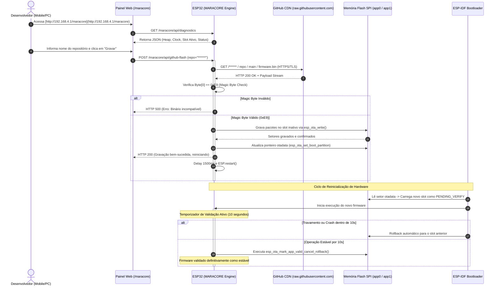

```markdown
<div align="center">

# ⚡ MARACORE // CLOUD ENGINE ⚡
### CONTINUOUS DEPLOYMENT (CD) & HARDWARE TELEMETRY FRAMEWORK FOR ESP32

[](#)
[](#)
[](#)
[](#)
[](#)

<br/>

<!-- VETOR DAS BANDEIRAS COM SVG INLINE -->
<p align="center">
  <rect width='27' height='2' y='0' fill='%23fff'/><rect width='27' height='2' y='2' fill='%23d81e05'/><rect width='27' height='2' y='4' fill='%23000'/><rect width='27' height='2' y='6' fill='%23fff'/><rect width='27' height='2' y='8' fill='%23d81e05'/><rect width='27' height='2' y='10' fill='%23000'/><rect width='27' height='2' y='12' fill='%23fff'/><rect width='27' height='2' y='14' fill='%23d81e05'/><rect width='27' height='2' y='16' fill='%23000'/><rect width='9' height='9' fill='%23002b7f'/><polygon points='4.5,1.5 5.4,4.2 8.2,4.2 6.0,5.9 6.8,8.5 4.5,6.9 2.2,8.5 3.0,5.9 0.8,4.2 3.6,4.2' fill='%23fff'/></svg>" alt="Maranhão" />
  &nbsp;&nbsp;&nbsp;&nbsp;
  <rect width='27' height='2.57' y='0' fill='%2300923f'/><rect width='27' height='2.57' y='2.57' fill='%23f8d117'/><rect width='27' height='2.57' y='5.14' fill='%2300923f'/><rect width='27' height='2.57' y='7.71' fill='%23f8d117'/><rect width='27' height='2.57' y='10.28' fill='%2300923f'/><rect width='27' height='2.57' y='12.85' fill='%23f8d117'/><rect width='27' height='2.57' y='15.42' fill='%2300923f'/><rect width='9' height='9' fill='%23d81e05'/><polygon points='4.5,1.8 5.3,4.2 7.7,4.2 5.8,5.7 6.5,8.1 4.5,6.6 2.5,8.1 3.2,5.7 1.3,4.2 3.7,4.2' fill='%23fff'/></svg>" alt="Piauí" />
  &nbsp;&nbsp;&nbsp;&nbsp;
  <rect width='27' height='18' fill='%23009c3b'/><polygon points='13.5,2 25,9 13.5,16 2,9' fill='%23ffdf00'/><circle cx='13.5' cy='9' r='4.2' fill='%23002776'/><path d='M 9.5,9.8 A 4.2 4.2 0 0 1 17.5,7.7' stroke='%23fff' stroke-width='0.8' fill='none'/></svg>" alt="Brasil" />
</p>


```

---

|  /  |   /\   |  __ \   /\      / / __ |  __ |  **|
| \  / |  /  \  | |**) | /  \    | |   | |  | | |**) | |**

| |/| | / /\ \ |  _  / / /\ \   | |   | |  | |  _  /|  |

| |  | |/ ____ | | \ / ____ \  | || |__| | | \ | |
||  |*/*/    __|  __/    _\  _****_***/|*|  _______|

```

> **Framework de nível industrial para substituição de mídias físicas microSD por entrega contínua de firmware diretamente dos servidores do GitHub, com proteção contra travamento (Anti-Brick Rollback), gerenciamento de conectividade NVS e diagnóstico físico do barramento I2C.**

</div>

---

## 📑 ÍNDICE GERAL

- [1. Visão Geral da Arquitetura](#1-visão-geral-da-arquitetura)
- [2. Diagrama de Sequência do Ciclo de Vida (UML)](#2-diagrama-de-sequência-do-ciclo-de-vida-uml)
- [3. Topologia da Memória Flash SPI](#3-topologia-da-memória-flash-spi)
- [4. Especificação Técnica ASD-STE100](#4-especificação-técnica-asd-ste100)
- [5. Mecanismo de Proteção e Anti-Rollback](#5-mecanismo-de-proteção-e-anti-rollback)
- [6. Estrutura dos Arquivos do Framework](#6-estrutura-dos-arquivos-do-framework)
- [7. Como Integrar em Novos Projetos](#7-como-integrar-em-novos-projetos)
- [8. Manual de Operação da API REST Embutida](#8-manual-de-operação-da-api-rest-embutida)
- [9. Organização dos Repositórios de Origem](#9-organização-dos-repositórios-de-origem)
- [10. Segurança e Política de Credenciais](#10-segurança-e-política-de-credenciais)

---

## 1. VISÃO GERAL DA ARQUITETURA

O **MARACORE** redefine o provisionamento de sistemas microcontrolados baseados no processador **Espressif ESP32**. Em sistemas IoT convencionais, a atualização de código em campo depende da extração mecânica de cartões de memória microSD ou de conexões físicas seriais USB-UART, o que acarreta:

- Desgaste físico dos contatos elétricos e risco de corrupção do sistema de arquivos FAT32.
- Necessidade de intervenção presencial no local de instalação da estação embarcada.
- Inviabilidade de reversão automática caso o novo firmware contenha erros de ponteiro ou travamentos (*Kernel Panic*).

O framework desacopla a camada de distribuição de software e introduz um pipeline de **Entrega Contínua (Continuous Deployment)**:


```

[ GITHUB REPOSITORY ]
│  Branch: main
│  Artefato: firmware.bin
│
▼ (HTTPS / TLS Direto)
[ ESP32 DEV ENGINE ] ── (Modo AP + STA) ──> [ NAVEGADOR DO CLIENTE ]
│                                                 │
├── Validação Magic Byte (0xE9)                   ├── Painel SPA (Vanilla JS)
├── Gravação Direta no Slot Inativo               ├── Scanner I2C Visual
└── Inversão de Ponteiro de Boot (otadata)        └── Seletor de Redes Wi-Fi

```

---

## 2. DIAGRAMA DE SEQUÊNCIA DO CICLO DE VIDA (UML)

O fluxo a seguir ilustra o ciclo operacional completo, desde a requisição de atualização via interface web até a validação definitiva da imagem pelo subsistema de proteção de boot:



---

## 3. TOPOLOGIA DA MEMÓRIA FLASH SPI

Para acomodar duas imagens completas de aplicação com seus respectivos cabeçalhos ELF e manter áreas dedicadas para configurações não-voláteis, a memória de 4 MB (32 Mb) é estruturada com partições simétricas:

```
0x000000 ┌────────────────────────────────────────┐
         │ Bootloader do Fabricante (ESP-IDF)     │  36 KB
0x009000 ├────────────────────────────────────────┤
         │ nvs (Non-Volatile Storage)             │  20 KB  (Credenciais e Ajustes)
0x00E000 ├────────────────────────────────────────┤
         │ otadata (Ponteiros de Inicialização)   │   8 KB  (Controle de Rollback)
0x010000 ├────────────────────────────────────────┤
         │                                        │
         │ app0 (Slot de Aplicação OTA 0)         │  1.920 KB (1,875 MB)
         │                                        │
0x1F0000 ├────────────────────────────────────────┤
         │                                        │
         │ app1 (Slot de Aplicação OTA 1)         │  1.920 KB (1,875 MB)
         │                                        │
0x3D0000 ├────────────────────────────────────────┤
         │ spiffs (Sistema de Arquivos Local)     │  192 KB
0x400000 └────────────────────────────────────────┘

```

### Configuração do Arquivo `partitions.csv`

```csv
# Name,   Type, SubType, Offset,   Size,     Flags
nvs,      data, nvs,     0x9000,   0x5000,
otadata,  data, ota,     0xe000,   0x2000,
app0,     app,  ota_0,   0x10000,  0x1E0000,
app1,     app,  ota_1,   0x1F0000, 0x1E0000,
spiffs,   data, spiffs,  0x3D0000, 0x30000,

```

---

## 4. ESPECIFICAÇÃO TÉCNICA ASD-STE100

O desenvolvimento do MARACORE segue os princípios do **ASD-STE100** (*Simplified Technical English* adaptado para Português Técnico):

1. **Uso de Frases Diretas e Afirmativas:** Instruções operacionais evitam termos ambíguos.
2. **Definição Única de Termos:**
* *Slot Ativo:* Partição de memória que executa o código no momento da consulta.
* *Slot Alvo:* Partição de memória inativa que recebe a nova imagem gravada.
* *Rollback:* Reversão automática para a versão de firmware prévia em caso de falha.


3. **Restrições de Memória:** O cliente seguro `WiFiClientSecure` deve operar em modo `setInsecure()` durante a conexão TLS para manter o consumo de heap abaixo de 40 KB, prevenindo esgotamento de memória no subsistema Wi-Fi.
4. **Validação de Cabeçalho:** O sistema deve abortar o processo se o primeiro byte do fluxo binário for diferente de `0xE9`.

---

## 5. MECANISMO DE PROTEÇÃO E ANTI-ROLLBACK

```
                 [ Gravação no Slot Inativo Concluída ]
                                  │
                                  ▼
           [ esp_ota_set_boot_partition() marca o slot ]
                                  │
                                  ▼
                        [ Reinício do ESP32 ]
                                  │
                                  ▼
             [ Bootloader inicia no estado PENDING_VERIFY ]
                                  │
                 ┌────────────────┴────────────────┐
                 ▼                                 ▼
         [ Falha / Travamento ]           [ Execução Estável ]
         [ antes de 10s ]                 [ por 10 segundos ]
                 │                                 │
                 ▼                                 ▼
      [ Rollback Automático ]           [ Cancela Rollback ]
      [ Retorna ao Slot Antigo ]        [ Marca Imagem Válida ]

```

O subsistema de integridade opera diretamente com as diretivas do **ESP-IDF OTA Engine**:

* Ao reiniciar após a gravação, a nova partição não se torna definitiva imediatamente. Ela entra em estado de observação (`ESP_OTA_IMG_PENDING_VERIFY`).
* Caso ocorra um *Watchdog Reset*, *Brownout* ou *Kernel Panic* antes de decorridos 10 segundos ininterruptos de execução, o circuito integrado de boot reverte o ponteiro para o slot estável anterior.
* Transcorridos 10 segundos sem falhas, o método `maracore.handle()` executa a instrução nativa:
```cpp
esp_ota_mark_app_valid_cancel_rollback();

```


Isso valida a partição como a nova imagem padrão do dispositivo.

---

## 6. ESTRUTURA DOS ARQUIVOS DO FRAMEWORK

Para manter a modularidade e garantir que todo projeto seja atualizável pelo próprio MARACORE, a estrutura do projeto deve conter os arquivos:

```text
meu-projeto-iot/
├── partitions.csv          # Tabela simétrica de 4 MB (app0 / app1)
├── platformio.ini          # Configurações de compilação (se usar PlatformIO)
├── include/
│   └── maracore.h          # Protótipos, definições de constantes e classes
└── src/
    ├── maracore.cpp        # Motor OTA, interface em PROGMEM e rotas REST
    └── main.cpp            # Ponto de entrada da aplicação hospedeira

```

---

## 7. COMO INTEGRAR EM NOVOS PROJETOS

A inclusão do MARACORE em qualquer firmware para ESP32 exige três passos:

### Passo 1: Instanciação e Inicialização no `main.cpp`

```cpp
#include <Arduino.h>
#include <WiFi.h>
#include <WebServer.h>
#include "maracore.h"

// Define o identificador textual do projeto
#define PROJECT_NAME "ESTACAO-ATALAIA"

WebServer server(80);
Maracore maracore;

void setup() {
    Serial.begin(115200);

    // Inicializa o MARACORE com o nome do projeto e 10 segundos de validação
    maracore.begin(&server, PROJECT_NAME, 10);

    // Rotas específicas da sua aplicação
    server.on("/", HTTP_GET, []() {
        server.send(200, "text/html", "<h1>Projeto Operacional</h1><a href='/maracore'>Painel MARACORE</a>");
    });

    server.begin();
    Serial.println(F("[SISTEMA] Servidor iniciado."));
}

void loop() {
    // Processa conexões web
    server.handleClient();

    // Executa a supervisão de boot e agendamentos do MARACORE
    maracore.handle();

    // Rotinas normais de leitura de sensores da aplicação
}

```

---

## 8. MANUAL DE OPERAÇÃO DA API REST EMBUTIDA

O framework expõe endpoints HTTP para controle automatizado por scripts ou integração com dashboards:

| Método | Endpoint | Parâmetros | Descrição da Operação |
| --- | --- | --- | --- |
| `GET` | `/maracore` | *Nenhum* | Retorna a Single Page Application (SPA) embutida na memória flash |
| `GET` | `/maracore/api/diagnostics` | *Nenhum* | Retorna telemetria de hardware, memória heap e slot ativo |
| `GET` | `/maracore/api/i2c-scan` | *Nenhum* | Executa varredura síncrona nos endereços 0x01 a 0x7F |
| `GET` | `/maracore/api/wifi-scan` | *Nenhum* | Varre o espectro local de radiofrequência 2.4 GHz |
| `POST` | `/maracore/api/wifi-connect` | `ssid`, `pass` | Registra novas credenciais Wi-Fi na memória NVS |
| `POST` | `/maracore/api/github-flash` | `repo` | Inicia o download HTTPS e gravação na partição inativa |
| `POST` | `/maracore/api/restart` | *Nenhum* | Executa reinicialização limpa do ESP32 |

### Exemplo de Retorno do Endpoint `/maracore/api/diagnostics`

```json
{
  "freeHeap": 178240,
  "minFreeHeap": 142100,
  "cpuFreqMHz": 240,
  "flashChipSize": 4194304,
  "uptime": 1420,
  "rssi": -62,
  "ip": "192.168.1.108",
  "wifiStatus": "CONNECTED",
  "activeSlot": "app0",
  "targetSlot": "app1",
  "pendingVerify": false
}

```

---

## 9. ORGANIZAÇÃO DOS REPOSITÓRIOS DE ORIGEM

Para que o deploy funcione sem configurações adicionais, a estrutura do repositório no GitHub deve seguir esta convenção:

1. **Visibilidade do Repositório:** O repositório deve ser configurado como **Público**.
2. **Branch de Distribuição:** Os binários devem ser consolidados na branch raiz `main`.
3. **Nome do Arquivo Binário:** O arquivo compilado gerado pela IDE ou pipeline de CI deve ser nomeado estritamente como:
```text
firmware.bin

```


4. **URL Canônica Montada pelo Dispositivo:**
```text
[https://raw.githubusercontent.com/******/](https://raw.githubusercontent.com/******/)<NOME_DO_REPOSITORIO>/main/firmware.bin

```


No painel `/maracore`, o usuário informa unicamente o identificador `<NOME_DO_REPOSITORIO>`. O ESP32 monta a rota, faz a negociação TLS, baixa o binário e atualiza a partição.

---

## 10. SEGURANÇA E POLÍTICA DE CREDENCIAIS

O MARACORE adota a política de segregação de segredos:

* Nenhuma credencial de rede privada, token pessoal de API ou chave de acesso deve ser mantida de forma fixa (*hardcoded*) no código-fonte.
* As credenciais de redes locais são fornecidas pelo usuário em tempo de execução via interface web ou API REST e gravadas na partição **NVS**, persistindo entre reinicializações e trocas de firmware.
* O download dos binários via CDN utiliza exclusivamente tráfego criptografado por protocolo **HTTPS/TLS (Porta 443)**.
* O framework rejeita qualquer arquivo cujo primeiro bloco de dados contenha assinatura diferente de `0xE9`, prevenindo a gravação de respostas de erro HTTP (como páginas HTML 404) dentro da memória Flash.

---

**MARACORE CLOUD ENGINE // SISTEMAS EMBARCADOS DE ALTA DISPONIBILIDADE**

Engenharia de Firmware desenvolvida sob a norma técnica ASD-STE100.
