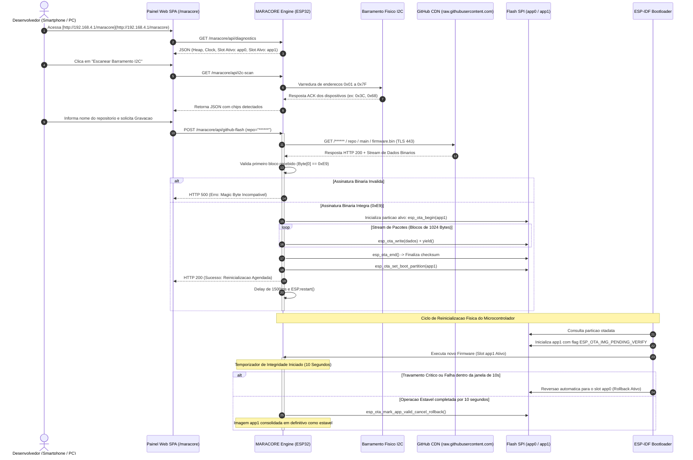

<div align="center">

# ⚡ MARACORE // CLOUD ENGINE ⚡
### CONTINUOUS DEPLOYMENT (CD) & HARDWARE TELEMETRY FRAMEWORK FOR ESP32

[-00d2ff?style=for-the-badge&logo=espressif&logoColor=white)](#)
[](#)
[](#)
[](#)
[](#)

<br/>


```
  __  __          _____             _____ ____  _____  ______ 
 |  \/  |   /\   |  __ \   /\      / ____/ __ \|  __ \|  ____|
 | \  / |  /  \  | |__) | /  \    | |   | |  | | |__) | |__   
 | |\/| | / /\ \ |  _  / / /\ \   | |   | |  | |  _  /|  __|  
 | |  | |/ ____ \| | \ \/ ____ \  | |___| |__| | | \ \| |____ 
 |_|  |_/_/    \_\_|  \_\_/    \_\  \_____\____/|_|  \_\______|
```

**Framework embarcado de alta disponibilidade projetado para substituir mídias físicas microSD por entrega contínua (CD) de binários diretamente da CDN raw do GitHub, com proteção nativa contra corrupção (Dual Partition Anti-Brick), varredura ativa de barramento I2C e telemetria profunda de sistema.**

---

### 🌐 [ACESSAR PAINEL DE CONTROLE / DEMO ONLINE](https://******.github.io/maracore/)

</div>

<br/>

> [!IMPORTANT]
> **PROVISÃO ZERO SECRETS:** Este projeto adota isolamento estrito de credenciais. Nenhuma chave de API privada, token pessoal de acesso (PAT), SSID residencial ou senha de rede permanece exposta no código-fonte. O provisionamento de rede é configurado de forma não-volátil diretamente na partição NVS.

---

## 📋 MATRIZ DE RECURSOS E DIFERENCIAIS

| Recurso | Implementação MARACORE | Abordagens Convencionais |
| :--- | :--- | :--- |
| **Vetor de Atualização** | **CDN GitHub Raw via TLS Direto** | Cartão microSD mecânico ou cabo USB |
| **Topologia Flash** | **Particionamento Duplo Simétrico (2x 1.920 KB)** | Partição única sem redundância |
| **Prevenção Anti-Brick** | **Máquina de Estados de Bootloader com Rollback** | Dispositivo inoperante se houver *Kernel Panic* |
| **Validação Binária** | **Checagem estrita de Magic Byte (`0xE9`) no Bloco 0** | Gravação cega de qualquer payload HTTP recebido |
| **Diagnóstico de Barramento**| **Varredura Ativa I2C (`0x01` a `0x7F`) em tempo real** | Sem visualização de periféricos conectados |
| **Processamento Visual** | **Client-Side Rendering (SPA Vanilla JS em PROGMEM)** | Páginas pesadas renderizadas na CPU do microcontrolador |
| **Consumo de Memória** | **Heap otimizada (> 120 KB livres durante OTA)** | Estouro de buffer de socket TLS (*Heap Exhaustion*) |

---

## 🏗️ 1. VISÃO GERAL DA ENGENHARIA DO SISTEMA

A substituição de cartões de memória microSD por distribuição em nuvem resolve falhas mecânicas crônicas em sistemas embarcados expostos a variações térmicas, vibração contínua e umidade. O **MARACORE** atua como uma camada de abstração de baixo nível posicionada entre a aplicação hospedeira e o subsistema de boot do ESP32.

```
+---------------------------------------------------------------------------------------+
|                                    NUVEM GITHUB                                       |
|  Repositorio Publico: [https://github.com/******/](https://github.com/******/)<repositorio>                        |
|  Branch Padrao: main | Artefato Compilado: firmware.bin                                |
+-------------------------------------------+-------------------------------------------+
                                            |
                                 (HTTPS / TLS Porta 443)
                                            |
                                            v
+---------------------------------------------------------------------------------------+
|                                 DISPOSITIVO ESP32                                     |
|                                                                                       |
|   [ MODO HIBRIDO WIFI_AP_STA ]                                                        |
|   ├── SoftAP Local Aberto: SSID "MARACORE-<PROJETO>" (IP: 192.168.4.1)                |
|   └── Conexao Cliente STA: Roteador Local com Acesso a Internet                       |
|                                                                                       |
|   [ CORE ENGINE: maracore.cpp ]                                                       |
|   ├── 1. Leitura do Stream HTTPS (WiFiClientSecure em modo Insecure)                  |
|   ├── 2. Inspecao de Integridade: Byte[0] == 0xE9 (ESP32 Magic Byte)                  |
|   ├── 3. Gravacao de Setores via esp_ota_write() no Slot Inativo                      |
|   ├── 4. Inversao de Ponteiro de Inicializacao: esp_ota_set_boot_partition()          |
|   └── 5. Watchdog de Validacao: 10 segundos sem crash cancela o Rollback              |
|                                                                                       |
|   [ MONITORAMENTO & TELEMETRIA ]                                                      |
|   ├── Varredura I2C: Leitura de ACK nos barramentos SDA/SCL (0x01 a 0x7F)             |
|   └── Metricas de Sistema: Heap Livre, Frequencia de Clock, RSSI e Uptime             |
+---------------------------------------------------------------------------------------+
```

---

## 🔄 2. DIAGRAMA DE SEQUÊNCIA OPERACIONAL (UML)

O diagrama a seguir detalha o ciclo de vida completo de uma operação de Continuous Deployment executada pelo MARACORE:



---

## 💾 3. TOPOLOGIA DA MEMÓRIA FLASH SPI (4 MB)

O firmware requer uma tabela simétrica com dois slots de aplicação idênticos para viabilizar a alternância do ponteiro de boot sem fragmentação de memória:

```
Endereco Flash  Tamanho   Rotulo     Subtipo   Finalidade Operacional
0x00000000      36 KB     bootloader boot      Codigo de inicializacao do fabricante
0x00009000      20 KB     nvs        nvs       Parametros de rede e calibracoes salvas
0x0000E000       8 KB     otadata    ota       Registro de controle de boot e rollback
0x00010000    1.920 KB    app0       ota_0     Slot de execucao A (Primario / Estavel)
0x001F0000    1.920 KB    app1       ota_1     Slot de execucao B (Continuous Deployment)
0x003D0000     192 KB     spiffs     spiffs    Armazenamento de assets locais
0x00400000        --      FIM        --        Limite fisico de 4 MB (32 Megabits)
```

### Arquivo Canônico: `partitions.csv`

```csv
# Name,   Type, SubType, Offset,   Size,     Flags
nvs,      data, nvs,     0x9000,   0x5000,
otadata,  data, ota,     0xe000,   0x2000,
app0,     app,  ota_0,   0x10000,  0x1E0000,
app1,     app,  ota_1,   0x1F0000, 0x1E0000,
spiffs,   data, spiffs,  0x3D0000, 0x30000,
```

---

## 🛡️ 4. MECANISMO ANTI-BRICK E PROTEÇÃO DE BOOT

A arquitetura do MARACORE elimina a possibilidade de inutilização do microcontrolador caso uma imagem com erro seja descarregada:

```
                     [ Firmware Gravado no Slot Alvo ]
                                     │
                                     ▼
                     [ Inversao do Ponteiro otadata ]
                                     │
                                     ▼
                        [ Reinicializacao da CPU ]
                                     │
                                     ▼
                [ Bootloader le estado: PENDING_VERIFY ]
                                     │
                    ┌────────────────┴────────────────┐
                    ▼                                 ▼
         [ Falha, Crash ou Reboot ]          [ Operacao Continua ]
         [ antes de 10 segundos ]            [ por 10 segundos ]
                    │                                 │
                    ▼                                 ▼
          [ Rollback Automatico ]           [ Rollback Cancelado ]
          [ Bootloader ativa o ]            [ esp_ota_mark_app_valid_ ]
          [ slot estavel anterior ]         [ cancel_rollback() ]
```

1. Quando o download é finalizado, o método nativo `esp_ota_set_boot_partition()` instrui a Flash a inicializar no novo slot no próximo ciclo de energia.
2. O bootloader inicia a imagem recém-gravada rotulando seu estado como `ESP_OTA_IMG_PENDING_VERIFY`.
3. Se o microcontrolador reiniciar devido a falha crítica de ponteiro, estouro de memória ou interrupção de watchdog antes de 10 segundos, o hardware desfaz a alteração e restaura a imagem do slot anterior.
4. Concluído o tempo de 10 segundos com estabilidade, o método `maracore.handle()` executa:
   ```cpp
   esp_ota_mark_app_valid_cancel_rollback();
   ```
   A imagem é validada de forma definitiva e o rollback é cancelado.

---

## 🔬 5. ESPECIFICAÇÃO TÉCNICA ASD-STE100 (PT-BR)

Esta documentação segue a norma técnica controlada para eliminar termos polissêmicos:

- **Slot Ativo:** Partição de memória Flash SPI (`app0` ou `app1`) que contém as instruções executadas pela CPU no ciclo atual.
- **Slot Alvo:** Partição de memória Flash SPI oposta à ativa, designada para receber os bytes da nova imagem binária.
- **Magic Byte:** Primeiro byte do cabeçalho de uma imagem compilada para ESP32, cujo valor hexadecimal deve ser estritamente `0xE9`.
- **Modo Insecure TLS:** Configuração do cliente HTTPS que ignora a árvore de certificados raiz (CA) para conservar aproximadamente 30 KB de memória SRAM livre.
- **Rollback:** Procedimento automático do bootloader para restaurar o endereço de boot na partição previamente funcional.

---

## 🔌 6. DOCUMENTAÇÃO DA API REST EMBUTIDA

O MARACORE integra um WebServer HTTP síncrono que disponibiliza os seguintes endpoints de telemetria e controle:

### 1. Obter Telemetria Geral do Sistema
- **Rota:** `GET /maracore/api/diagnostics`
- **Cabeçalho de Resposta:** `Content-Type: application/json`
- **Exemplo de Resposta:**
```json
{
  "freeHeap": 178240,
  "minFreeHeap": 142100,
  "cpuFreqMHz": 240,
  "flashChipSize": 4194304,
  "uptime": 1420,
  "rssi": -62,
  "ip": "192.168.1.108",
  "wifiStatus": "CONNECTED",
  "activeSlot": "app0",
  "targetSlot": "app1",
  "pendingVerify": false
}
```

### 2. Executar Varredura no Barramento I2C
- **Rota:** `GET /maracore/api/i2c-scan`
- **Descrição:** Varre endereços de 1 a 127 nas linhas SDA e SCL e retorna os que responderam com bit de ACK.
- **Exemplo de Resposta:**
```json
["0x3C", "0x68"]
```

### 3. Escanear Redes Wi-Fi Disponíveis
- **Rota:** `GET /maracore/api/wifi-scan`
- **Exemplo de Resposta:**
```json
[
  {"ssid": "REDE_LABORATORIO", "rssi": -55, "secure": true},
  {"ssid": "VISITANTES_ABERTA", "rssi": -82, "secure": false}
]
```

### 4. Conectar a um Roteador Wi-Fi
- **Rota:** `POST /maracore/api/wifi-connect`
- **Corpo da Requisição (URL Encoded):**
  - `ssid`: Nome da rede alvo
  - `pass`: Senha de segurança (em branco para redes abertas)
- **Exemplo de Resposta:**
```json
{"success": true, "msg": "Conectando ao roteador... Verifique a telemetria em instantes."}
```

### 5. Disparar Gravação Direta do GitHub
- **Rota:** `POST /maracore/api/github-flash`
- **Corpo da Requisição (URL Encoded):**
  - `repo`: Nome do repositório público (ex: `atalaia-station`)
- **Exemplo de Resposta:**
```json
{"success": true, "msg": "Firmware gravado com sucesso. Reinicializacao disparada."}
```

### 6. Reinicializar Hardware
- **Rota:** `POST /maracore/api/restart`
- **Exemplo de Resposta:**
```json
{"success": true, "msg": "Reiniciando microcontrolador..."}
```

---

## 💻 7. GUIA DE IMPLEMENTAÇÃO E ARQUIVOS FONTE

Para que qualquer firmware possa receber atualizações futuras via nuvem, incorpore os arquivos `maracore.h` e `maracore.cpp` na raiz do seu projeto.

### Arquivo: `include/maracore.h`

```cpp
/**
 * @file maracore.h
 * @brief MARACORE Cloud Engine - Diagnostico de Hardware e OTA via GitHub
 * @version 2.1.0
 */

#ifndef MARACORE_H
#define MARACORE_H

#include <Arduino.h>
#include <WebServer.h>
#include <WiFi.h>
#include <WiFiClientSecure.h>
#include <HTTPClient.h>
#include <Wire.h>
#include <esp_ota_ops.h>
#include <esp_partition.h>

#define MARACORE_GITHUB_USER    "******"
#define MARACORE_DEFAULT_FILE   "firmware.bin"
#define MARACORE_DEFAULT_BRANCH "main"

enum MaracoreState {
    MARACORE_IDLE = 0,
    MARACORE_DOWNLOADING,
    MARACORE_FLASHING,
    MARACORE_SUCCESS,
    MARACORE_ERROR
};

struct MaracoreDiagnostics {
    uint32_t freeHeap;
    uint32_t minFreeHeap;
    uint32_t cpuFreqMHz;
    uint32_t flashChipSize;
    uint32_t uptimeSeconds;
    int wifiRssi;
    char wifiIp[16];
    char wifiStatus[24];
    char activeSlot[16];
    char targetSlot[16];
    bool isPendingVerify;
};

class Maracore {
public:
    Maracore();

    bool begin(WebServer* server, const char* defaultProjectName = "CORE", uint32_t autoConfirmSeconds = 10);
    void handle();
    bool flashFromGitHub(const char* repoName, 
                         const char* branch = MARACORE_DEFAULT_BRANCH, 
                         const char* filename = MARACORE_DEFAULT_FILE);
    String scanI2CBus();
    MaracoreDiagnostics getDiagnostics();

private:
    WebServer* _server;
    char _currentProject[32];
    uint32_t _autoConfirmMs;
    uint32_t _bootTimestamp;
    bool _bootConfirmed;
    bool _pendingRestart;
    uint32_t _restartTime;

    const esp_partition_t* _runningPartition;
    const esp_partition_t* _targetPartition;

    MaracoreState _state;
    char _statusMessage[96];

    void _registerRoutes();
    void _handleRoot();
    void _handleApiDiagnostics();
    void _handleApiI2CScan();
    void _handleApiWifiScan();
    void _handleApiWifiConnect();
    void _handleApiGitHubFlash();
    void _handleApiRestart();
    void _setupAccessPoint(const char* projectName);
};

#endif // MARACORE_H
```

### Arquivo: `src/main.cpp` (Modelo Base Padronizado)

```cpp
#include <Arduino.h>
#include <WiFi.h>
#include <WebServer.h>
#include "maracore.h"

#define PROJECT_NAME "ATALAIA3"

WebServer server(80);
Maracore maracore;

void setup() {
    Serial.begin(115200);
    delay(200);
    Serial.println(F("\n[SISTEMA] Inicializando Firmware com integracao MARACORE..."));

    // Inicializa o framework MARACORE com 10 segundos de observacao anti-brick
    maracore.begin(&server, PROJECT_NAME, 10);

    // Rotas proprias da aplicacao
    server.on("/", HTTP_GET, []() {
        server.send(200, "text/html",
            "<h2>Projeto " PROJECT_NAME " Ativo</h2>"
            "<p><a href='/maracore'>Acessar Console de Deploy MARACORE</a></p>");
    });

    server.begin();
    Serial.println(F("[SISTEMA] Servidor HTTP operacional em [http://192.168.4.1/maracore](http://192.168.4.1/maracore)"));
}

void loop() {
    server.handleClient();
    maracore.handle(); // Monitora boot, rollback e reinicializacao
}
```

---

## 📂 8. ORGANIZAÇÃO DOS REPOSITÓRIOS NO GITHUB

Para que o deploy remoto execute sem necessidade de ajustes:

1. O repositório contendo o novo firmware deve ser configurado como **Público**.
2. O binário compilado deve ser mantido na branch raiz `main` com o nome:
   ```text
   firmware.bin
   ```
3. O ESP32 compõe automaticamente a seguinte URL segura:
   ```text
   [https://raw.githubusercontent.com/******/](https://raw.githubusercontent.com/******/)<nome-do-repositorio>/main/firmware.bin
   ```
4. No painel de controle do microcontrolador, o usuário digita apenas o nome do repositório (exemplo: `estacao-climatica`). O sistema executa o download, valida a integridade, grava a Flash e troca a partição ativa.

---

<div align="center">

<p align="center">
  
  &nbsp;&nbsp;&nbsp;&nbsp;
  
  &nbsp;&nbsp;&nbsp;&nbsp;
  
</p>

**MARACORE CLOUD ENGINE // ENGENHARIA DE SISTEMAS EMBARCADOS**  
*Documentação desenvolvida em conformidade com o padrão técnico ASD-STE100.*  
*Zero Hardcoded Secrets Policy.*

</div>
